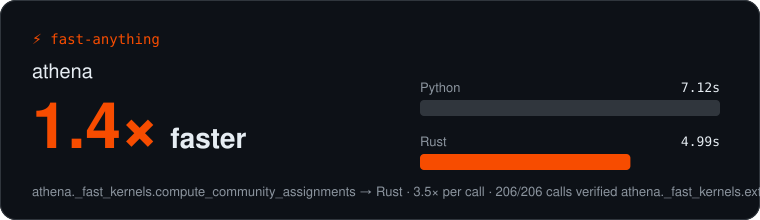

# ⚡ athena: 1.4× faster

`python src/_fa_workload.py` went from **7.12s** to **4.99s** (median of 5 runs each, original and Rust interleaved).

| function | per call | checked against |
|---|---|---|
| `athena._fast_kernels.compute_community_assignments` | **3.5×** (9.6ms → 2.7ms) | 206/206 recorded real calls |
| `athena._fast_kernels.extract_structural_symbols_raw` | **1.9×** (16.2µs → 8.6µs) | 800/800 recorded real calls |
| `athena._fast_kernels.score_graph_trigrams` | **8.8×** (37.3ms → 4.2ms) | 330/330 recorded real calls |
| `athena.security.redact_secrets` | **41×** (237.3µs → 5.8µs) | 776/776 recorded real calls |

The original code stays in place: set `FAST_ANYTHING_DISABLE=1` to run it, or `fast-anything disable <id>` to remove the switch.

Made with [fast-anything](https://github.com/EL4CTEO/fast-anything)
