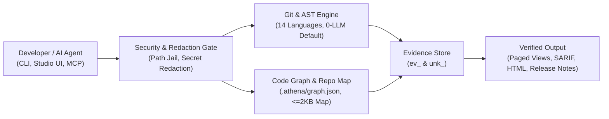

<p align="center">
  
</p>

# Athena (`athena-mcp`)

> **Your git diff says it is safe. Athena checks the callers.**

[](https://github.com/aaryanrwt/athena/actions/workflows/athena-audit.yml)
[](https://github.com/aaryanrwt/athena/releases/tag/v1.3.1)
[](https://www.python.org/)
[](https://modelcontextprotocol.io/)
[](#how-it-works)
[](LICENSE)
[](https://github.com/aaryanrwt/athena/stargazers)
[](https://m8ven.ai/mcp/aaryanrwt/athena?s=readme)
[](https://hub.xerj.org/contributors/aaryanrwt)

Athena is a **local-first code intelligence tool** (CLI, Terminal UI, and MCP server). It runs offline on your machine—no cloud APIs or vector databases required—to help both developers and AI coding agents:

1. **Catch breaking changes before you merge** (renamed/removed symbols, parameter shifts, unguarded `None` defaults, recursion bugs, and broken callers).
2. **Map and query any codebase in seconds** (`athena graph` & `athena map`), cutting agent token usage by **49x–2,067x** on real repositories.
3. **Track technical debt** (`athena debt`) by binding `# shortcut: <limit>, <when to upgrade>` comments directly to functions and classes.
4. **Plug into any AI coding agent** (`athena install`)—Hermes, OpenClaw, Claude Code, Codex, Cursor, and Pi—with safe, backed-up configs.

## Table of Contents

- [Quickstart](#quickstart)
- [Everyday Commands](#everyday-commands)
- [How It Works](#how-it-works)
- [Project & Folder Architecture](#project--folder-architecture)
- [Real-World Benchmark (10 Languages, 100+ Commits Each)](#real-world-benchmark-10-languages-100-commits-each)
- [Use It in GitHub Actions](#use-it-in-github-actions)
- [Star History](#star-history)
- [Further Reading](#further-reading)

---

## Quickstart

```bash
git clone https://github.com/aaryanrwt/athena.git
cd athena
pip install -e .

# Open the interactive Terminal Studio
athena ui

# Get a <=2KB architectural map of any repo
athena map .

# Check for breaking changes before committing
athena check --staged
```

---

## Everyday Commands

| Command | What it does |
| :--- | :--- |
| `athena ui` | Launches the interactive terminal studio (auto-starts when run in a terminal). |
| `athena map .` | Prints a `<=2000`-character export map of shared modules and symbols. |
| `athena graph . --query "auth"` | Builds/queries `.athena/graph.json` with trigram search + hub-guarded BFS. |
| `athena breaking-changes . --base main --target HEAD` | Finds potential breaking API changes, caller impact, and doc drift. |
| `athena check --staged` | Pre-commit gate: exits non-zero if staged changes break public APIs. |
| `athena affected-tests .` | Predicts pytest, Playwright `.spec.ts`, and unit tests impacted by a diff. |
| `athena debt .` | Lists `shortcut: <limit>, <when to upgrade>` debt markers with AST symbols. |
| `athena install --agent hermes` | Installs Athena skills/hooks for `hermes`, `openclaw`, `claude-code`, `codex`, `cursor`, or `pi`. |
| `athena init-mcp cursor` | Generates ready-to-paste MCP config JSON (`claude-desktop`, `cursor`, `vscode`). |

---

## How It Works



- **Zero-LLM by default:** Everything runs deterministically offline. Local Ollama (`qwen2.5-coder:7b` / `gemma:latest`) is strictly optional (`--llm`).
- **Never fakes completeness:** Unresolved dynamic calls (`getattr`, `eval`, oversized files) are tracked explicitly as `ResidualUnknown` (`unk_<sha256>`) records instead of being hidden.
- **Context-friendly MCP:** Heavy tools support `detail="summary"` and return a `parent_evidence_id` that agents can page through with `inspect_analysis_view`.

---

## Project & Folder Architecture

```text
athena/
├── src/athena/
│   ├── cli.py                # CLI entry point (ui, mcp, graph, map, debt, install, check, report, semver-check)
│   ├── tui.py                # Interactive Athena Studio Terminal UI
│   ├── mcp_server.py         # 12-tool stdio MCP server with ToolAnnotations & hot/cold discovery
│   ├── git_inspector.py      # Safe git diff/history extraction (GIT_NO_LAZY_FETCH=1, flag-injection guards)
│   ├── ast_analyzer.py       # Python ast contract/recursion differ + 13-language structural scanner
│   ├── graph_store.py        # Persistent .athena/graph.json builder, SHA-256 cache & atomic snapshots
│   ├── graph_query.py        # Trigram+IDF scorer, hub-guarded BFS, god_nodes & shortest_path
│   ├── repo_map.py           # <=2KB zero-search architectural export map
│   ├── debt_tracker.py       # AST-bound `shortcut:` technical debt scanner
│   ├── evidence_store.py     # Canonical ev_<sha256> & unk_<sha256> store + paged inspection
│   ├── agent_installer.py    # Transactional installer for Hermes, OpenClaw, Claude Code, Codex, Cursor & Pi
│   ├── gates.py              # Staged pre-commit & SemVer bump gates
│   ├── sarif.py              # SARIF 2.1.0 exporter
│   ├── html_report.py        # CSP-hardened single-file HTML report renderer
│   ├── release_notes.py      # Deterministic & optional Ollama release-note pipeline
│   ├── ollama_engine.py      # Optional local Ollama integration (gemma:latest / qwen2.5-coder:7b)
│   ├── symbol_cache.py       # Content-addressed parsed symbol cache
│   ├── mcp_config.py         # MCP client config generator (Claude Desktop, Cursor, VS Code)
│   ├── verifier.py           # Ground-truth evidence verifier & hallucination guard
│   ├── security.py           # Path jail, symlink defense, NTFS ADS guard & Rust-accelerated secret redaction
│   ├── _fast_kernels.py      # Plain-data hot kernels with verified Rust PyO3 fast-anything ports
│   └── models.py             # Pydantic v2 schemas
├── skills/athena/SKILL.md    # Portable Athena agent protocol skill
├── docs/                     # CLI examples, evaluation reports, CI/Docker integrations & demo tape
├── tests/                    # Automated unit, MCP stdio, release-readiness & evaluation suites
├── .github/                  # CI workflows (athena-audit, action-smoke) & PR comment renderer
├── action.yml                # Reusable GitHub Action
├── Dockerfile                # Rootless container image
└── pyproject.toml            # Package & Python 3.12-3.15 metadata
```

---

## Real-World Benchmark (v1.3.1)

Tested offline across **13 new repositories** (**3 NVIDIA 2026 & CUDA repos** over `1,000+` commits + **10 diverse high-star repos** across JS, TS/Go, Rust, C/C#, Kotlin, Ruby, PHP, TeX): **13/13 passed with 0 errors**.

| Repository | Language | Stars | Span | Files | Nodes / Edges | Cold -> Warm Cache | Token Reduction |
| :--- | :--- | ---: | :--- | ---: | ---: | ---: | ---: |
| `NVIDIA/auto-ontology` | Python (2026) | 14,568 | `HEAD~1000` | 897 | 7,486 / 23,258 | 33.3s -> 1.9s | **618.6x** |
| `NVIDIA/NeMo-Relay` | Rust (2026) | 257 | `HEAD~1000` | 1,560 | 32,331 / 48,324 | 82.3s -> 6.7s | **3,025.0x** |
| `NVIDIA/cuvs` | CUDA / C++ | 903 | `HEAD~1000` | 1,269 | 6,148 / 7,184 | 34.2s -> 1.8s | **1,330.2x** |
| `facebook/react` | JavaScript | 252,934 | `HEAD~100` | 4,161 | 20,714 / 19,216 | 236.8s -> 12.5s | **1,453.0x** |
| `microsoft/PowerToys` | C / C# | 141,325 | `HEAD~100` | 2,415 | 9,088 / 6,780 | 128.3s -> 6.3s | **1,258.6x** |
| `microsoft/TypeScript` | TypeScript / Go | 111,875 | `HEAD~100` | 503 | 7,879 / 7,907 | 29.3s -> 2.8s | **1,052.1x** |
| `fatedier/frp` | Go | 110,732 | `HEAD~100` | 247 | 2,653 / 2,436 | 11.7s -> 1.0s | **250.3x** |
| `denoland/deno` | Rust | 109,038 | `HEAD~100` | 1,697 | 33,010 / 35,688 | 107.6s -> 8.6s | **2,411.5x** |
| `laravel/laravel` | PHP / Blade | 85,480 | `HEAD~1000` | 24 | 81 / 69 | 1.4s -> 0.2s | **4.4x** |
| `rails/rails` | Ruby | 59,182 | `HEAD~1000` | 3,099 | 20,635 / 19,311 | 129.3s -> 12.0s | **1,335.2x** |
| `JetBrains/kotlin` | Kotlin | 53,614 | `HEAD~100` | 4,406 | 16,278 / 12,611 | 183.1s -> 9.7s | **1,794.9x** |
| `dotnet/runtime` | C# | 18,461 | `HEAD~100` | 4,334 | 18,661 / 14,424 | 229.6s -> 11.4s | **1,978.0x** |
| `latex3/latex2e` | TeX | 2,523 | `HEAD~1000` | 154 | 561 / 393 | 9.8s -> 0.4s | **1,527.1x** |

### Hybrid Rust Acceleration (Zero Degradation)

Athena keeps its Python MCP/AST architecture intact and accelerates its hottest kernels via batched Git `cat-file --batch` I/O and verified **Rust PyO3 extensions** built with [`EL4CTEO/fast-anything`](https://github.com/EL4CTEO/fast-anything), automatically falling back to pure Python when unbuilt or when `FAST_ANYTHING_DISABLE=1` is set:

- **Kernel speedups (`fast-anything verify`)**: `redact_secrets` **41x** (`776/776` calls), `score_graph_trigrams` **8.8x** (`330/330` calls), `compute_community_assignments` **3.5x** (`206/206` calls), `extract_structural_symbols_raw` **1.9x** (`800/800` calls).
- **Batched Git blob reads**: cut `athena` (`v1.0.0..v1.3.1`) breaking-change analysis from **12.74s -> 3.17s (`4.02x` faster)**.
- **Real-world `NVIDIA/cuvs` verification** (`1,269` files, `6,152` nodes, `7,188` edges): `build_code_graph` sped up **9.63x** (`31.39s -> 3.26s`), 20 graph queries sped up **4.31x** (`7.80s -> 1.81s`), overall workflow **3.21x** (`50.85s -> 15.83s`), with identical SHA-256 `graph_evidence_id` and breaking-change findings.

```bash
# Optional: compile native Rust accelerations locally into .fast/lib/
python scripts/build_rust_accel.py

# Toggle pure-Python fallback at any time
FAST_ANYTHING_DISABLE=1 athena graph . --query "auth"
```

Full version-by-version test history (`v1.0.0` -> `v1.3.1`) and Rust parity audit: [docs/evaluation.md](docs/evaluation.md).

---

## Use It in GitHub Actions

```yaml
- uses: actions/checkout@3d3c42e5aac5ba805825da76410c181273ba90b1 # v7.0.1
  with:
    fetch-depth: 0
- uses: aaryanrwt/athena@v1.3.1
```

Posts one sticky breaking-change & blast-radius summary per PR. See [docs/integrations.md](docs/integrations.md) for Docker, pre-commit, and permissions setup.

---

## Star History

<a href="https://www.star-history.com/#aaryanrwt/athena&Date">
  <picture>
    <source media="(prefers-color-scheme: dark)" srcset="https://api.star-history.com/svg?repos=aaryanrwt/athena&type=Date&theme=dark" />
    <source media="(prefers-color-scheme: light)" srcset="https://api.star-history.com/svg?repos=aaryanrwt/athena&type=Date" />
    
  </picture>
</a>

---

## Further Reading

- [CLI Examples](docs/cli-examples.md)
- [Benchmarks & Evaluation](docs/evaluation.md)
- [CI, Docker & Pre-Commit Integrations](docs/integrations.md)
- [Changelog](CHANGELOG.md)
- [Security Policy](SECURITY.md)
- [Contributing](CONTRIBUTING.md)

**Maintainer:** Aaryan Rawat ([`aaryan28rwt@gmail.com`](mailto:aaryan28rwt@gmail.com)) · Licensed under [Apache-2.0](LICENSE).
