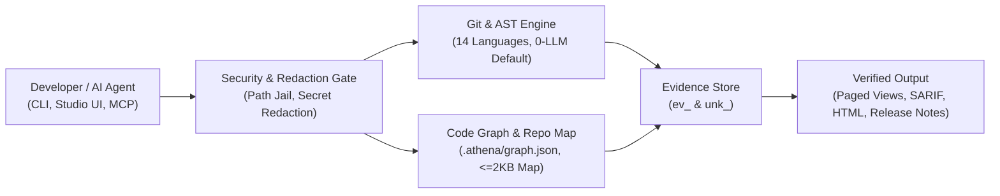

<p align="center">
  
</p>

# Athena (`athena-mcp`)

> **Your git diff says it is safe. Athena checks the callers.**

[](https://github.com/aaryanrwt/athena/actions/workflows/athena-audit.yml)
[](https://github.com/aaryanrwt/athena/releases/tag/v1.3.0)
[](https://www.python.org/)
[](https://modelcontextprotocol.io/)
[](#how-it-works)
[](LICENSE)
[](https://github.com/aaryanrwt/athena/stargazers)
[](https://m8ven.ai/mcp/aaryanrwt/athena?s=readme)
[](https://hub.xerj.org/contributors/aaryanrwt)

Athena is a **local-first code intelligence tool** (CLI, Terminal UI, and MCP server). It runs offline on your machine—no cloud APIs or vector databases required—to help both developers and AI coding agents:

1. **Catch breaking changes before you merge** (renamed/removed symbols, parameter shifts, unguarded `None` defaults, recursion bugs, and broken callers).
2. **Map and query any codebase in seconds** (`athena graph` & `athena map`), cutting agent token usage by **49x–2,067x** on real repositories.
3. **Track technical debt** (`athena debt`) by binding `# shortcut: <limit>, <when to upgrade>` comments directly to functions and classes.
4. **Plug into any AI coding agent** (`athena install`)—Hermes, OpenClaw, Claude Code, Codex, Cursor, and Pi—with safe, backed-up configs.

## Table of Contents

- [Quickstart](#quickstart)
- [Everyday Commands](#everyday-commands)
- [How It Works](#how-it-works)
- [Project & Folder Architecture](#project--folder-architecture)
- [Real-World Benchmark (10 Languages, 100+ Commits Each)](#real-world-benchmark-10-languages-100-commits-each)
- [Use It in GitHub Actions](#use-it-in-github-actions)
- [Star History](#star-history)
- [Further Reading](#further-reading)

---

## Quickstart

```bash
git clone https://github.com/aaryanrwt/athena.git
cd athena
pip install -e .

# Open the interactive Terminal Studio
athena ui

# Get a <=2KB architectural map of any repo
athena map .

# Check for breaking changes before committing
athena check --staged
```

---

## Everyday Commands

| Command | What it does |
| :--- | :--- |
| `athena ui` | Launches the interactive terminal studio (auto-starts when run in a terminal). |
| `athena map .` | Prints a `<=2000`-character export map of shared modules and symbols. |
| `athena graph . --query "auth"` | Builds/queries `.athena/graph.json` with trigram search + hub-guarded BFS. |
| `athena breaking-changes . --base main --target HEAD` | Finds potential breaking API changes, caller impact, and doc drift. |
| `athena check --staged` | Pre-commit gate: exits non-zero if staged changes break public APIs. |
| `athena debt .` | Lists `shortcut: <limit>, <when to upgrade>` debt markers with AST symbols. |
| `athena install --agent hermes` | Installs Athena skills/hooks for `hermes`, `openclaw`, `claude-code`, `codex`, `cursor`, or `pi`. |
| `athena init-mcp cursor` | Generates ready-to-paste MCP config JSON (`claude-desktop`, `cursor`, `vscode`). |

---

## How It Works



- **Zero-LLM by default:** Everything runs deterministically offline. Local Ollama (`qwen2.5-coder:7b` / `gemma:latest`) is strictly optional (`--llm`).
- **Never fakes completeness:** Unresolved dynamic calls (`getattr`, `eval`, oversized files) are tracked explicitly as `ResidualUnknown` (`unk_<sha256>`) records instead of being hidden.
- **Context-friendly MCP:** Heavy tools support `detail="summary"` and return a `parent_evidence_id` that agents can page through with `inspect_analysis_view`.

---

## Project & Folder Architecture

```text
athena/
├── src/athena/
│   ├── cli.py                # CLI entry point (ui, mcp, graph, map, debt, install, check, report, semver-check)
│   ├── tui.py                # Interactive Athena Studio Terminal UI
│   ├── mcp_server.py         # 12-tool stdio MCP server with ToolAnnotations & hot/cold discovery
│   ├── git_inspector.py      # Safe git diff/history extraction (GIT_NO_LAZY_FETCH=1, flag-injection guards)
│   ├── ast_analyzer.py       # Python ast contract/recursion differ + 13-language structural scanner
│   ├── graph_store.py        # Persistent .athena/graph.json builder, SHA-256 cache & atomic snapshots
│   ├── graph_query.py        # Trigram+IDF scorer, hub-guarded BFS, god_nodes & shortest_path
│   ├── repo_map.py           # <=2KB zero-search architectural export map
│   ├── debt_tracker.py       # AST-bound `shortcut:` technical debt scanner
│   ├── evidence_store.py     # Canonical ev_<sha256> & unk_<sha256> store + paged inspection
│   ├── agent_installer.py    # Transactional installer for Hermes, OpenClaw, Claude Code, Codex, Cursor & Pi
│   ├── gates.py              # Staged pre-commit & SemVer bump gates
│   ├── sarif.py              # SARIF 2.1.0 exporter
│   ├── html_report.py        # CSP-hardened single-file HTML report renderer
│   ├── release_notes.py      # Deterministic & optional Ollama release-note pipeline
│   ├── ollama_engine.py      # Optional local Ollama integration (gemma:latest / qwen2.5-coder:7b)
│   ├── symbol_cache.py       # Content-addressed parsed symbol cache
│   ├── mcp_config.py         # MCP client config generator (Claude Desktop, Cursor, VS Code)
│   ├── verifier.py           # Ground-truth evidence verifier & hallucination guard
│   ├── security.py           # Path jail, symlink defense, NTFS ADS guard & secret redaction
│   └── models.py             # Pydantic v2 schemas
├── skills/athena/SKILL.md    # Portable Athena agent protocol skill
├── docs/                     # CLI examples, evaluation reports, CI/Docker integrations & demo tape
├── tests/                    # Automated unit, MCP stdio, release-readiness & evaluation suites
├── .github/                  # CI workflows (athena-audit, action-smoke) & PR comment renderer
├── action.yml                # Reusable GitHub Action
├── Dockerfile                # Rootless container image
└── pyproject.toml            # Package & Python 3.12-3.15 metadata
```

---

## Real-World Benchmark (10 Languages, 100+ Commits Each)

Tested offline on **10 fresh 10k+-star repositories** (`396,964` cumulative stars, `1,000` commits `HEAD~100..HEAD`, `8,804` source files): **10/10 passed with 0 errors**.

| Repository | Language | Stars | Files | Graph Nodes / Edges | Cold -> Warm Cache | Token Reduction | Breaking Findings |
| :--- | :--- | ---: | ---: | ---: | ---: | ---: | ---: |
| `psf/requests` | Python | 54,735 | 37 | 744 / 2,407 | 1.8s -> 0.4s | **49.0x** | 15 |
| `trpc/trpc` | TypeScript | 40,847 | 1,477 | 8,012 / 11,200 | 63.1s -> 4.9s | **636.7x** | 28 |
| `spf13/cobra` | Go | 44,809 | 36 | 647 / 623 | 2.0s -> 0.3s | **62.8x** | 8 |
| `serde-rs/serde` | Rust | 10,993 | 208 | 2,918 / 2,710 | 7.9s -> 1.2s | **130.9x** | 71 |
| `axios/axios` | JavaScript | 109,387 | 287 | 1,142 / 909 | 18.3s -> 0.7s | **167.5x** | 4 |
| `gabime/spdlog` | C++ | 29,787 | 155 | 383 / 230 | 4.7s -> 0.4s | **138.7x** | 38 |
| `square/okhttp` | Java | 47,116 | 647 | 5,650 / 5,003 | 29.3s -> 2.3s | **483.4x** | 0 |
| `rubocop/rubocop` | Ruby | 12,925 | 1,797 | 22,518 / 20,721 | 59.9s -> 7.4s | **1,249.1x** | 11 |
| `JamesNK/Newtonsoft.Json` | C# | 11,321 | 951 | 2,780 / 1,829 | 43.1s -> 2.9s | **770.1x** | 4 |
| `laravel/framework` | PHP | 35,024 | 3,209 | 41,105 / 37,897 | 251.0s -> 14.0s | **2,067.5x** | 2 |

---

## Use It in GitHub Actions

```yaml
- uses: actions/checkout@3d3c42e5aac5ba805825da76410c181273ba90b1 # v7.0.1
  with:
    fetch-depth: 0
- uses: aaryanrwt/athena@v1.3.0
```

Posts one sticky breaking-change & blast-radius summary per PR. See [docs/integrations.md](docs/integrations.md) for Docker, pre-commit, and permissions setup.

---

## Star History

<a href="https://www.star-history.com/#aaryanrwt/athena&Date">
  <picture>
    <source media="(prefers-color-scheme: dark)" srcset="https://api.star-history.com/svg?repos=aaryanrwt/athena&type=Date&theme=dark" />
    <source media="(prefers-color-scheme: light)" srcset="https://api.star-history.com/svg?repos=aaryanrwt/athena&type=Date" />
    
  </picture>
</a>

---

## Further Reading

- [CLI Examples](docs/cli-examples.md)
- [Benchmarks & Evaluation](docs/evaluation.md)
- [CI, Docker & Pre-Commit Integrations](docs/integrations.md)
- [Changelog](CHANGELOG.md)
- [Security Policy](SECURITY.md)
- [Contributing](CONTRIBUTING.md)

**Maintainer:** Aaryan Rawat ([`aaryan28rwt@gmail.com`](mailto:aaryan28rwt@gmail.com)) · Licensed under [Apache-2.0](LICENSE).
