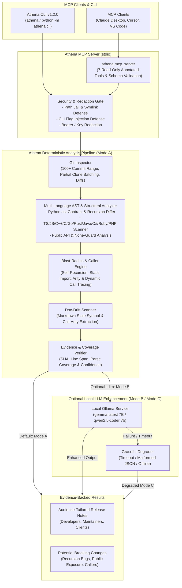

<p align="center">
  
</p>

# Athena (`athena-mcp`)

> **Your git diff says it is safe. Athena checks the callers.**

[](https://github.com/aaryanrwt/athena/actions/workflows/athena-audit.yml)
[](https://www.python.org/)
[](LICENSE)
[](https://m8ven.ai/mcp/aaryanrwt/athena?s=readme)
[](https://hub.xerj.org/contributors/aaryanrwt)

Local-first, evidence-backed breaking-change and caller blast-radius analysis for git diffs, available as an MCP server, a CLI, a GitHub Action, and a pre-commit hook. Deterministic by default: no LLM, no network.

## Quickstart

```bash
# 1. Clone and install locally
git clone https://github.com/aaryanrwt/athena.git
cd athena
pip install -e .

# 2. Launch the interactive Athena Studio TUI
athena ui

# 3. Register Athena with your MCP client (cursor, claude-desktop, vscode)
athena init-mcp cursor

# 4. Detect potential breaking changes across git revisions
athena breaking-changes . --base main --target HEAD
```

<!-- Demo GIF: generate with docs/demo.tape (see docs/demo-gif.md). Not committed until recorded from a real run. -->
<p align="center">
  
</p>

## Use it in CI

```yaml
- uses: actions/checkout@3d3c42e5aac5ba805825da76410c181273ba90b1 # v7.0.1
  with:
    fetch-depth: 0
- uses: aaryanrwt/athena@v1.2.0
```

Posts one sticky comment per PR. Also available as a Docker image and a pre-commit hook (`athena check --staged`). Details, permissions, and the safe `pull_request` vs `pull_request_target` guidance are in [docs/integrations.md](docs/integrations.md).

## What's Included in v1.2.0

Athena v1.2.0 expands from an offline MCP server into a complete developer change-intelligence toolkit:

- **Athena Studio Terminal UI (`athena ui`)**: An interactive terminal studio featuring retro modular block typography, warm terracotta palette (`#D97757`), live Git repository context cards, and one-click actions. Automatic TTY detection launches the studio when run interactively, and routes directly to the JSON-RPC stdio server when piped into MCP clients.
- **One-Click MCP Client Configuration (`athena init-mcp`)**: Generates or writes ready-to-use configuration JSON for **Claude Desktop**, **Cursor**, and **VS Code**.
- **SARIF 2.1.0 Static Analysis Export (`athena breaking-changes --format sarif`)**: Formats breaking-change findings directly into standard SARIF for native GitHub Code Scanning and IDE security viewers.
- **Pre-Commit Breaking Change Gate (`athena check --staged`)**: Fast, deterministic index-vs-HEAD check for pre-commit hooks (`.pre-commit-hooks.yaml`). Non-zero exit on breaking changes without modifying files or git refs.
- **Standalone Single-File HTML Reports (`athena report --html`)**: Generates an interactive, zero-dependency HTML audit report with visual call graphs, blast radius trees, and unified diff citations.
- **Automated SemVer Bump Gate (`athena semver-check`)**: Analyzes AST mutations against declared version bumps (`patch`, `minor`, `major`) and fails CI builds when breaking API changes are detected under a non-major version.
- **Content-Hash Parsed Symbol Caching (`--cache-dir` / `ATHENA_CACHE_DIR`)**: Incremental SHA-256 symbol caching for high-speed repeated analysis in large codebases.
- **AST Recursion Defect Analysis & Hardening**: Fixed Pydantic validation for recursive function mutations (`behavior_changed`) discovered during empirical multi-repository runs.
- **Docker Support & Hardened GitHub Actions**: Full rootless container support (`Dockerfile`) and pinned, immutable GitHub Actions workflow (`action.yml`).

## Results at a Glance & Empirical Testing

Athena's performance and accuracy are verified across thousands of real-world commits and top open-source codebases:

| Metric | Result |
| :--- | :--- |
| **Automated Test Suite** | **158 automated tests** (157 offline deterministic tests + 1 opt-in live Ollama integration; 100% pass) |
| **Baseline Multi-Language Corpus** | **55 repositories** across 11 languages (100% pass rate over 100+ commits each) |
| **Commits Inspected (Baseline)** | **5,500 commits** (`HEAD~100..HEAD`) |
| **Diff Hunks Processed** | **10,680 hunks** |
| **Recursive Functions Analyzed** | **411 functions** |
| **Ground-Truth Semantic Scenarios** | **19 / 19 scenarios passed (100.0% accuracy)** |
| **Top-Tier Scale Corpus (Chunk 1)** | **66 repositories evaluated**; **30 passed** (**8,339,176 cumulative stars**, 100% pass on 4/4 MCP tools; 36 clone transport timeouts) |
| **5-Pass Consistency Verification** | **100 repositories tested across 5 consecutive passes**; **10 passed completely** (deterministic 0-drift), **89 failed on partial blobless clones** (`GIT_NO_LAZY_FETCH=1` security block), and **1 caught a real engine schema bug** (`pallets/click` `behavior_changed`), which was fixed and unit-tested |
| **Average Mode A Analysis Duration** | **7s – 45s per 100 commits** (100% offline rule-based core) |

Full methodology, manifests, and tables: [docs/evaluation.md](docs/evaluation.md).

## Documentation

- [CLI examples with verified output](docs/cli-examples.md)
- [Benchmarks and evaluation](docs/evaluation.md)
- [GitHub Action, Docker, pre-commit, maintainer setup](docs/integrations.md)
- [Generating the demo GIF](docs/demo-gif.md)

**Maintainer**: Aaryan Rawat ([`aaryan28rwt@gmail.com`](mailto:aaryan28rwt@gmail.com))

Athena is an open-source, local-first Model Context Protocol (MCP) server and developer CLI that delivers **verifiable, ground-truth code-change intelligence**. It combines deterministic Git diff analysis, Python `ast` and multi-language structural signature comparison (**TypeScript, JavaScript, Python, C++, C, Go, Rust, Java, Kotlin, Scala, C#, Ruby, PHP, Swift**), downstream caller blast-radius tracing, and documentation-drift detection.

---
## Key Differentiators (v1.2.0)

1. **Deterministic-First Core (100% LLM-Independent)**: Athena works out-of-the-box completely offline without Ollama, without an external API, and without any network connection. All Git inspections, AST symbol deltas, caller blast-radius graphs, doc-drift warnings, and release notes execute deterministically with 0ms LLM wait time.
2. **Multi-Language Structural & AST Diffing (v1.2.0)**: Full Python `ast` contract and recursion analysis plus structural symbol & signature comparison across **TypeScript, JavaScript, C++, C, Go, Rust, Java, Kotlin, Scala, C#, Ruby, PHP, and Swift** — detecting removed public symbols, parameter additions/removals, visibility narrowing, and return-type mutations across 100+ commit histories.
3. **Ground-Truth Evidence Citations**: Every reported change story and potential breaking change is bound to verified `EvidenceRecord` items containing the 40-character commit SHA, commit subject, file path, exact base/target line spans, unified diff hunk header/excerpt, and confidence rating.
4. **AST Contract Differencing & Recursive Function Defect Analysis**: Athena ignores misleading Conventional Commit prefixes (e.g. `fix:` commit messages that actually introduce new public methods or break signatures). It analyzes parameter defaults, positional-parameter index shifts (`BUG-030`), `None`-fallback body guards (`griffe#469`), return-type annotations, `(str, Enum)` <-> `StrEnum` migrations (`griffe#501`), Enum members, public constants, newly raised exceptions (`griffe#498`), and **recursive function bugs** (broken recursive self-call arity, unconditional infinite recursion without a base case, unqualified class-method self-recursion `NameError`s, and self-recursive caller blast radius).
5. **Public API Exposure Differentiation**: Automatically distinguishes symbols exported via `__all__`, package `__init__.py` re-exports, TypeScript `export` declarations, Go exported identifiers, Rust `pub` items, and Java/C#/C++ `public` symbols (`is_public_api_export=True`) from internal/private helpers (`is_public_api_export=False`) so teams know when external package consumers are at risk even if internal callers look clean.
6. **Unresolved Dynamic Dispatch Detection & Coverage Confidence Score**: Scans repository ASTs for reflection and dynamic invocation patterns (`getattr`, `hasattr`, `setattr`, `globals()`, `locals()`, `eval`, `exec`, `importlib.import_module`, and TypeScript bracket dispatch `obj[key]()`) and emits an explicit `AnalysisCoverageReport` (`static_parse_coverage_pct`, `unresolved_dynamic_calls_count`, `overall_blast_radius_confidence`) so CI and PR reviewers never get a false sense of security.
7. **Three Resilient Operating Modes (Supporting `gemma:latest` / Gemma 7B & `qwen2.5-coder:7b`)**:
   - **Mode A (Deterministic-only, Default)**: High-speed, 100% offline rule-based engine.
   - **Mode B (Optional Local Ollama Enhancement)**: When requested (`--llm`, `use_llm=True`, or `ATHENA_ENABLE_LLM=1`), local Ollama (`gemma:latest` / `gemma:7b` or `qwen2.5-coder:7b`) enhances narrative explanations while strictly verifying evidence citations against deterministic ground truth. Includes automatic VRAM swap eviction for 6 GB GPUs.
   - **Mode C (Fault-Tolerant Fallback)**: If Ollama times out, returns malformed JSON, or is offline, Athena gracefully degrades to deterministic output with clear diagnostic warnings.
8. **Drop-In GitHub Actions PR Audit Bot (`action.yml`)**: Ships with a ready-to-use GitHub Actions workflow that runs the multi-Python test matrix and posts a structured Breaking-Change, Blast-Radius & Release Notes summary table directly to `$GITHUB_STEP_SUMMARY` on every Pull Request.
9. **Private & Accurately Annotated MCP Tools**: Athena marks analysis tools read-only. Its two release tools disclose their optional file-writing capability and write only when `output_file` is explicitly supplied; they never commit or push code. Athena runs locally on consumer hardware (verified on an NVIDIA RTX 4050 Laptop GPU with 6 GB VRAM and 16 GB RAM).

---

## Architecture



---

## Installation & Setup

### Prerequisites

- **Python**: `>= 3.12` (verified on Python `3.12`, `3.13`, and `3.14`)
- **Git**: `>= 2.30` (verified on `git 2.53`)
- *(Optional)* **Ollama**: Local Ollama server at `http://127.0.0.1:11434` with `gemma:latest` (Gemma 7B, `a72c7f4d0a15`, ~5.0 GB) and/or `qwen2.5-coder:7b` (`dae161e27b0e`, ~4.7 GB) if Mode B is desired.

### Portable Installation

Clone the repository and install Athena in a clean virtual environment:

```bash
# 1. Clone repository
git clone https://github.com/aaryanrwt/athena.git
cd athena

# 2. Create and activate virtual environment
python -m venv .venv

# On Linux / macOS:
source .venv/bin/activate

# On Windows (PowerShell):
.venv\Scripts\Activate.ps1

# 3. Install in editable development mode
pip install -e .
```

---

## MCP Server Configuration

Athena communicates via standard JSON-RPC 2.0 over standard I/O (`stdio`).

### Claude Desktop (`claude_desktop_config.json`)

Add Athena to your Claude Desktop configuration file:
- **macOS**: `~/Library/Application Support/Claude/claude_desktop_config.json`
- **Windows**: `%APPDATA%\Claude\claude_desktop_config.json`

```json
{
  "mcpServers": {
    "athena": {
      "command": "athena",
      "args": ["mcp"],
      "env": {
        "ATHENA_ENABLE_LLM": "0"
      }
    }
  }
}
```

*Note*: To enable optional local Ollama enhancement (`gemma:latest` or `qwen2.5-coder:7b`), set `"ATHENA_ENABLE_LLM": "1"`.

### Cursor / VS Code / Other MCP Clients

For generic MCP clients using executable commands:

```json
{
  "athena": {
    "command": "python",
    "args": ["-m", "athena.cli", "mcp"]
  }
}
```

---

## Registered MCP Tools

Athena exposes **7 schema-validated MCP tools**. Five analysis tools are annotated read-only. The two release tools are annotated as write-capable because they can create or replace an explicitly requested `output_file`:

| MCP Tool Name | Primary Parameters | Description |
| :--- | :--- | :--- |
| `inspect_repository` | `repo_path` (str), `max_recent_commits` (int, default 10) | Safely inspects branch status, tags, HEAD commit, clean status, and recent commits. |
| `analyze_git_history` | `repo_path` (str), `base_ref` (str, default "AUTO"), `target_ref` (str, default "HEAD"), `max_commits` (int, default 100, up to 500), `use_llm` (bool, default False) | Extracts bounded revision range (`100+` commits), commit history, unified diffs, and multi-language AST/structural symbol deltas into grounded change stories. |
| `detect_potential_breaking_changes` | `repo_path` (str), `base_ref` (str, default "AUTO"), `target_ref` (str, default "HEAD"), `include_low_confidence` (bool, default False), `use_llm` (bool, default False) | Detects signature mutations, removed symbols, newly raised exceptions, base class changes, affected downstream callers, and documentation drift. |
| `generate_release_notes` | `repo_path` (str), `base_ref` (str, default "AUTO"), `target_ref` (str, default "HEAD"), `release_version` (str, default "Unreleased"), `audience` (str: `end_users` \| `developers` \| `maintainers` \| `clients`), `output_file` (str, optional), `overwrite` (bool, default False), `use_llm` (bool, default False) | Synthesizes audience-tailored Markdown release notes with evidence citations, upgrade considerations, and potential breaking changes. |
| `analyze_change_graph` | `repo_path` (str), `base_ref` (str), `head_ref` (str, default "HEAD"), `max_commits` (int, default 100) | Inspects deterministic symbol delta graph, caller blast radius, and commit history across `base_ref..head_ref`. |
| `verify_breaking_and_doc_drift` | `repo_path` (str), `base_ref` (str), `head_ref` (str, default "HEAD"), `include_low_confidence` (bool, default False) | Verifies breaking changes, documentation drift, and caller impact across `base_ref..head_ref`. |
| `generate_verified_release_brief` | `repo_path` (str), `base_ref` (str), `head_ref` (str, default "HEAD"), `release_version` (str), `audience` (str) | Generates structured Markdown + JSON release brief backed by verified commit and diff evidence. |

---

---

## CLI Usage

Run `athena <subcommand> [options]` (or `python -m athena.cli <subcommand>`). Subcommands include `inspect`, `analyze`, `breaking-changes`, and `release-notes`. Verified output for each, run against [`examples/demo_repo`](examples/demo_repo), is in [docs/cli-examples.md](docs/cli-examples.md).

---

## Evaluation & Benchmarks

Summary above; full 55-repository table, the 19-scenario ground-truth benchmark, and engineering defect reports (BUG-001 through BUG-039) are in [docs/evaluation.md](docs/evaluation.md).

---
## Tested Security Controls & Boundaries

- **Path Canonicalization & Jail**: All filesystem paths are resolved and validated with `is_relative_to(repo_root)`. Path traversal attempts (e.g. `../../etc/passwd` or symlink escapes) are blocked with `INVALID_REPO_PATH`.
- **Windows Device Name & ADS Guards**: Output file paths are verified against Windows reserved device names (`CON`, `PRN`, `AUX`, `NUL`, `COM1-9`, `LPT1-9`) and NTFS Alternate Data Stream colons (`:`) to prevent device locks and stream injection.
- **CLI Flag Injection & `.gitconfig` Spoofing Neutralization**: Revisions and arguments passed to Git subprocesses are validated to prevent flag injection attacks (blocking leading `-`, `--upload-pack`, `-o`, `--exec`), and all Git commands enforce `-c diff.noprefix=false -c diff.mnemonicPrefix=false -c color.ui=never`.
- **Safe File Writing**: Release-note writing requires explicit `overwrite=True` to prevent destructive overwriting of existing changelogs.
- **Pre-LLM Secret Redaction**: High-entropy strings, AWS tokens (`AKIA...`), GitHub personal access tokens (`ghp_...`), Bearer headers, and private keys are redacted prior to LLM or markdown exposure.
- **Prompt Injection Isolation**: Repository content forwarded to optional LLMs is strictly fenced inside `<untrusted_repo_content>` XML tags with explicit system instructions to ignore embedded directives.

---

## Current Scope & Limitations

- **Language AST & Structural Support**: Full AST contract and recursion defect analysis (parameter defaults, body guards, return types, exception raises, base classes, Enum members, public constants, recursive self-call arity, and infinite recursion base-case detection) is implemented for **Python**. Multi-language structural symbol, signature, parameter arity, visibility, export diffing, and recursive self-call arity analysis is supported for **TypeScript, JavaScript, C++, C, Go, Rust, Java, Kotlin, Scala, C#, Ruby, PHP, and Swift**.
- **Inter-file Caller Resolution & Dynamic Dispatch**: Static caller analysis resolves callers across local modules within the same repository using import hierarchy tracking (including aliased imports and self-recursive calls) and verifies call-site argument arity. When reflection (`getattr`), dynamic imports (`importlib.import_module`), or bracket dispatch (`handlers[action]()`) are present, Athena explicitly flags them in `unresolved_dynamic_calls` and adjusts `analysis_coverage.overall_blast_radius_confidence` so reviewers know the exact boundary of static analysis.
- **Read-Only Operation**: Athena does not write tags, create branches, or commit code to external repositories.
- **Partial/Blobless Clones**: Athena disables implicit Git lazy-fetching during analysis. A partial clone must already contain the objects required for the requested range; otherwise Athena returns a Git extraction error instead of contacting its remote without explicit operator action.

---

## Running the Automated Test Suite

Athena has **128 tests** covering multi-language structural and recursive diffing, security boundaries, MCP stdio roundtrips, and real-world edge cases. The default offline run executes 127 tests and skips one explicitly opt-in live Ollama integration test:

```bash
# Run the offline suite (127 passed, 1 live Ollama test skipped)
python -m pytest -v

# Optional live Ollama test (Linux/macOS)
ATHENA_RUN_OLLAMA_TESTS=1 python -m pytest -v -m ollama

# Optional live Ollama test (Windows PowerShell)
$env:ATHENA_RUN_OLLAMA_TESTS = "1"; python -m pytest -v -m ollama

# Run 19-scenario ground-truth semantic quality & Gemma 7B / Qwen 7B benchmark
python tests/evaluation/run_quality_benchmark.py

# Run v1.2.0 multi-language 100+ commit & MCP repository evaluation (55 repos, 10k+ stars)
python tests/evaluation/run_evaluation.py --manifest tests/evaluation/v1_1_multilang_manifest.json --limit 55 --clone-depth 125 --target-commits 100 --llm --model dual
```

---

## Owner & Maintainer

- **Name**: Aaryan Rawat
- **Email**: [`aaryan28rwt@gmail.com`](mailto:aaryan28rwt@gmail.com)
- **GitHub**: [@aaryanrwt](https://github.com/aaryanrwt)
- **Project history**: [`CHANGELOG.md`](CHANGELOG.md)
- **Maintainer feedback and follow-up**: [`MAINTAINER_FEEDBACK.md`](MAINTAINER_FEEDBACK.md)

---

## License

Athena is licensed under the [Apache License, Version 2.0](LICENSE).
