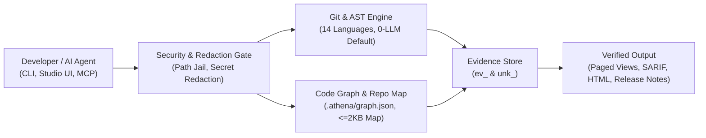

<p align="center">
  
</p>

<h1 align="center">Athena (<code>athena-mcp</code>)</h1>

<p align="center">
  <em>Your git diff says it is safe. Athena checks the callers.</em>
</p>

<p align="center">
  <a href="#before-vs-after-rust-integration">
    
  </a>
</p>

<p align="center">
  <a href="https://github.com/aaryanrwt/athena/actions/workflows/athena-audit.yml"></a>
  <a href="https://github.com/aaryanrwt/athena/releases"></a>
  <a href="https://github.com/aaryanrwt/athena/stargazers"></a>
  <a href="https://github.com/aaryanrwt/athena/commits/main"></a>
  <a href="LICENSE"></a>
  <br />
  <a href="https://m8ven.ai/mcp/aaryanrwt/athena?s=readme"></a>
  <a href="https://hub.xerj.org/contributors/aaryanrwt"></a>
</p>

Athena is a **local-first code intelligence tool** (CLI, Terminal UI, and MCP server). It runs offline on your machine—no cloud APIs or vector databases required—to help both developers and AI coding agents:

1. **Catch breaking changes before you merge** (renamed/removed symbols, parameter shifts, unguarded `None` defaults, unit-shift hints, recursion bugs, and broken callers).
2. **Map and query any codebase in seconds** (`athena graph` & `athena map`), cutting agent token usage by **49x–81,438x** on real repositories.
3. **Predict affected tests & track technical debt** (`athena affected-tests` for pytest/Playwright + `athena debt` for `# shortcut:` markers).
4. **Plug into any AI coding agent** (`athena install`)—Hermes, OpenClaw, Claude Code, Codex, Cursor, and Pi—with safe, backed-up configs and optional **Hybrid Rust acceleration**.

## Table of Contents

- [Quickstart](#quickstart)
- [Everyday Commands](#everyday-commands)
- [How It Works](#how-it-works)
- [Project & Folder Architecture](#project--folder-architecture)
- [v1.3.2 5-Company Benchmark & v1.3.1 Comparison](#v132-5-company-benchmark--v131-comparison)
- [Real-World Benchmark (v1.3.1)](#real-world-benchmark-v131)
- [Before vs. After Rust Integration](#before-vs-after-rust-integration)
- [Use It in GitHub Actions](#use-it-in-github-actions)
- [Star History](#star-history)
- [Further Reading](#further-reading)

---

## Quickstart

```bash
git clone https://github.com/aaryanrwt/athena.git
cd athena
pip install -e .

# Open the interactive Terminal Studio
athena ui

# Get a <=2KB architectural map of any repo
athena map .

# Check for breaking changes before committing
athena check --staged
```

---

## Everyday Commands

| Command | What it does |
| :--- | :--- |
| `athena ui` | Launches the interactive terminal studio (auto-starts when run in a terminal). |
| `athena doctor .` | Checks live Python, Git, MCP SDK, Rust acceleration, evidence store, and repo state. |
| `athena mcp --toolsets git,graph --read-only` | Runs Athena's MCP server (`stdio` or loopback `streamable-http`) with toolset/read-only scoping, resources, and workflow prompts. |
| `athena map .` | Prints a `<=2000`-character export map of shared modules and symbols. |
| `athena graph . --query "auth"` | Builds/queries `.athena/graph.json` with trigram search + hub-guarded BFS. |
| `athena breaking-changes . --base main --target HEAD` | Finds potential breaking API changes, caller impact, and doc drift (`--detail summary` retains `ev_<sha256>` on disk). |
| `athena view <ev_id> --facet potential_breaking_changes` | Pages through retained `ev_<sha256>` evidence bundles across CLI/MCP sessions. |
| `athena check --staged` | Pre-commit gate: exits non-zero if staged changes break public APIs. |
| `athena affected-tests .` | Predicts pytest, Playwright `.spec.ts`, and unit tests impacted by a diff (supports `--offset`/`--limit`). |
| `athena debt .` | Lists `shortcut: <limit>, <when to upgrade>` debt markers with AST symbols (supports `--offset`/`--limit`). |
| `athena install --agent hermes` | Installs Athena skills/hooks for `hermes`, `openclaw`, `claude-code`, `codex`, `cursor`, or `pi`. |
| `athena init-mcp cursor` | Generates ready-to-paste MCP config JSON (`claude-desktop`, `cursor`, `vscode`). |

---

## How It Works



- **Zero-LLM by default:** Everything runs deterministically offline. Local Ollama (`qwen2.5-coder:7b` / `gemma:latest`) is strictly optional (`--llm`).
- **Never fakes completeness:** Unresolved dynamic calls (`getattr`, `eval`, oversized files) are tracked explicitly as `ResidualUnknown` (`unk_<sha256>`) records instead of being hidden.
- **Context-friendly & 2026 MCP native:** Heavy tools support `detail="summary"` with cross-process disk-backed `ev_<sha256>` paging (`inspect_analysis_view` / `athena view`), while `athena mcp` exposes 4 read-only Resources/Templates (`athena://server/capabilities`, `athena://repo/map`, `athena://evidence/recent`, `athena://evidence/{evidence_id}`), 3 guided workflow prompts, `--toolsets`/`--read-only` scoping, and loopback-guarded `streamable-http` transport.

---

## Project & Folder Architecture

```text
athena/
├── src/athena/
│   ├── cli.py                # CLI entry point (ui, doctor, mcp, graph, map, view, affected-tests, debt, install, check, report, semver-check)
│   ├── tui.py                # Interactive Athena Studio Terminal UI
│   ├── mcp_server.py         # Scoped stdio / loopback streamable-http MCP server (13 tools, resources, URI templates & prompts)
│   ├── git_inspector.py      # Safe git diff & batched cat-file extractor (GIT_NO_LAZY_FETCH=1, TOCTOU drift guard)
│   ├── ast_analyzer.py       # Python ast contract/unit-shift/recursion differ + 14-language structural scanner
│   ├── graph_store.py        # Persistent .athena/graph.json builder, TS barrel/PHP/CUDA/TeX graph & atomic snapshots
│   ├── graph_query.py        # Trigram+IDF scorer, hub-guarded BFS, god_nodes & shortest_path
│   ├── test_selector.py      # Predictive test selection (pytest, Playwright .spec.ts/.e2e.ts, unit tests)
│   ├── repo_map.py           # <=2KB zero-search architectural export map
│   ├── debt_tracker.py       # AST-bound `shortcut:` technical debt scanner
│   ├── evidence_store.py     # Canonical ev_<sha256> & unk_<sha256> store + paged inspection
│   ├── agent_installer.py    # Transactional installer for Hermes, OpenClaw, Claude Code, Codex, Cursor & Pi
│   ├── gates.py              # Staged pre-commit & SemVer bump gates
│   ├── sarif.py              # SARIF 2.1.0 exporter
│   ├── html_report.py        # CSP-hardened single-file HTML report renderer
│   ├── release_notes.py      # Deterministic & optional Ollama release-note pipeline
│   ├── ollama_engine.py      # Optional local Ollama integration (gemma:latest / qwen2.5-coder:7b)
│   ├── symbol_cache.py       # Content-addressed parsed symbol cache
│   ├── mcp_config.py         # MCP client config generator (Claude Desktop, Cursor, VS Code)
│   ├── verifier.py           # Ground-truth evidence verifier & hallucination guard
│   ├── security.py           # Path jail, symlink defense, NTFS ADS guard & Rust-accelerated secret redaction
│   ├── _fast_kernels.py      # Plain-data hot kernels with verified Rust PyO3 fast-anything ports
│   └── models.py             # Pydantic v2 schemas
├── skills/athena/SKILL.md    # Portable Athena agent protocol skill
├── docs/                     # CLI examples, evaluation reports, CI/Docker integrations & demo tape
├── tests/                    # Automated unit, MCP stdio, release-readiness & evaluation suites
├── .github/                  # CI workflows (athena-audit, action-smoke) & PR comment renderer
├── action.yml                # Reusable GitHub Action
├── Dockerfile                # Rootless container image
└── pyproject.toml            # Package & Python 3.13-3.15 metadata
```

---

## v1.3.2 5-Company Benchmark & v1.3.1 Comparison

Tested offline across **5 fresh enterprise repositories** (`1,050–1,091` commits each; **`5,291` commits** and **`63.8M` raw tokens / `255.2 MB`** total across `8,798` scanned files, `60,693` graph nodes, `192,208` edges, `366` breaking findings, and `2,180` predicted tests):

### What We Found Because of This Test (In Plain English)

1. **We caught and fixed a real 5-minute hang on huge repositories:** On Meta's `llama-stack` (`40.7M` tokens across `1,050` commits), `v1.3.1` got stuck and timed out after 5 minutes (`300.14s`) because it ran secret-redaction regexes on giant diff chunks before trimming them and re-scanned documentation repeatedly. Fixing that dropped the exact same scan to **37.57 seconds** (and made the other four repos **6.02x to 17.92x faster**) while catching the exact same `61` breaking changes.
2. **Most of the speed gain came from smarter code, not just Rust:** Even with Rust turned completely off (`FAST_ANYTHING_DISABLE=1`), `v1.3.2` ran **5.45x to 14.47x faster** than `v1.3.1`; turning Rust on pushed that to **6.02x to 17.92x faster** with identical breaking-change counts and graph hashes across all 5 repos.
3. **Huge diffs no longer flood an AI assistant's context window:** Raw reports on these repos were **3.13 MB to 12.03 MB** of JSON. With `--detail summary`, Athena returns a **~644-byte summary** with a saved ID and lets you inspect details later in a separate `athena view` command—which failed **5/5 times** in `v1.3.1` (memory-only) and now works **5/5 times** in `v1.3.2` (saved to disk).
4. **Massive token savings for AI agents:** Using Athena's `<=2KB` repo map and focused graph queries instead of reading raw repositories cut context size by **5,103.0x to 81,438.6x** (map) and **1,333.8x to 20,892.4x** (query).
5. **Bad inputs and giant test lists are handled cleanly:** `v1.3.1` silently accepted invalid flags like `athena map --max-chars -10` and dumped up to **994 predicted tests (276 KB)** at once on `microsoft/semantic-kernel`. `v1.3.2` rejects bad flags clearly (`INVALID_MAX_CHARS`), pages large test lists (`--limit 5` cuts `276,493 B` to `1,955 B`), and adds `athena doctor` for one-command setup checks.
6. **One honest caveat we observed:** On Apple's `mlx`, a single cold Windows Rust graph build had subprocess startup variance (`18.03s` vs `5.87s` pure Python), even though breaking-change scanning on the same repo still jumped **15.89x faster** (`176.68s -> 11.12s`).

| Company & Repo | Commits | Breaking Scan (`v1.3.1 -> v1.3.2`) | Report Size (Full -> Summary) | Map Savings |
| :--- | :---: | :--- | ---: | ---: |
| **Google** (`google/go-github`, Go) | `1,050` | `133.26s ->` **`22.15s`** `(6.02x faster)` | `4.02 MB -> 644 B` | **`5,103.0x`** |
| **Apple** (`ml-explore/mlx`, C++/Py) | `1,050` | `176.68s ->` **`11.12s`** `(15.89x faster)` | `3.13 MB -> 644 B` | **`6,026.7x`** |
| **OpenAI** (`openai/openai-python`, Py) | `1,091` | `284.69s ->` **`30.98s`** `(9.19x faster)` | `6.33 MB -> 646 B` | **`11,246.0x`** |
| **Meta** (`meta-llama/llama-stack`, Py/TS) | `1,050` | `TIMEOUT 300.14s ->` **`37.57s`** `(>8.0x)` | `12.03 MB -> 644 B` | **`81,438.6x`** |
| **Microsoft** (`microsoft/semantic-kernel`, C#/Py) | `1,050` | `223.71s ->` **`12.48s`** `(17.92x faster)` | `9.67 MB -> 644 B` | **`24,290.1x`** |

Full Python-vs-Rust timings, SHA-256 graph parity hashes, and `athena view` / `affected-tests` / `doctor` comparisons: [docs/evaluation.md](docs/evaluation.md).

---

## Real-World Benchmark (v1.3.1)

Tested offline across **13 new repositories** (**3 NVIDIA 2026 & CUDA repos** over `1,000+` commits + **10 diverse high-star repos** across JS, TS/Go, Rust, C/C#, Kotlin, Ruby, PHP, TeX): **13/13 passed with 0 errors**.

| Repository | Language | Stars | Span | Files | Nodes / Edges | Cold -> Warm Cache | Token Reduction |
| :--- | :--- | ---: | :--- | ---: | ---: | ---: | ---: |
| `NVIDIA/auto-ontology` | Python (2026) | 14,568 | `HEAD~1000` | 897 | 7,486 / 23,258 | 33.3s -> 1.9s | **618.6x** |
| `NVIDIA/NeMo-Relay` | Rust (2026) | 257 | `HEAD~1000` | 1,560 | 32,331 / 48,324 | 82.3s -> 6.7s | **3,025.0x** |
| `NVIDIA/cuvs` | CUDA / C++ | 903 | `HEAD~1000` | 1,269 | 6,148 / 7,184 | 34.2s -> 1.8s | **1,330.2x** |
| `facebook/react` | JavaScript | 252,934 | `HEAD~100` | 4,161 | 20,714 / 19,216 | 236.8s -> 12.5s | **1,453.0x** |
| `microsoft/PowerToys` | C / C# | 141,325 | `HEAD~100` | 2,415 | 9,088 / 6,780 | 128.3s -> 6.3s | **1,258.6x** |
| `microsoft/TypeScript` | TypeScript / Go | 111,875 | `HEAD~100` | 503 | 7,879 / 7,907 | 29.3s -> 2.8s | **1,052.1x** |
| `fatedier/frp` | Go | 110,732 | `HEAD~100` | 247 | 2,653 / 2,436 | 11.7s -> 1.0s | **250.3x** |
| `denoland/deno` | Rust | 109,038 | `HEAD~100` | 1,697 | 33,010 / 35,688 | 107.6s -> 8.6s | **2,411.5x** |
| `laravel/laravel` | PHP / Blade | 85,480 | `HEAD~1000` | 24 | 81 / 69 | 1.4s -> 0.2s | **4.4x** |
| `rails/rails` | Ruby | 59,182 | `HEAD~1000` | 3,099 | 20,635 / 19,311 | 129.3s -> 12.0s | **1,335.2x** |
| `JetBrains/kotlin` | Kotlin | 53,614 | `HEAD~100` | 4,406 | 16,278 / 12,611 | 183.1s -> 9.7s | **1,794.9x** |
| `dotnet/runtime` | C# | 18,461 | `HEAD~100` | 4,334 | 18,661 / 14,424 | 229.6s -> 11.4s | **1,978.0x** |
| `latex3/latex2e` | TeX | 2,523 | `HEAD~1000` | 154 | 561 / 393 | 9.8s -> 0.4s | **1,527.1x** |

## Before vs. After Rust Integration

Athena keeps its Python CLI, MCP server, Pydantic schemas, and Python `ast` precision intact (`pip install athena-mcp` works anywhere with pure-Python fallback), while porting its hottest pure kernels to Rust PyO3 extensions via [`EL4CTEO/fast-anything`](https://github.com/EL4CTEO/fast-anything) and batching Git blob reads (`git cat-file --batch`).

### 3-Company `1,000+` Commit Before vs. After Quality & Parity Audit

Verified side-by-side (`FAST_ANYTHING_DISABLE=1` pure Python vs. Rust PyO3 enabled) across **NVIDIA**, **Google**, and **Microsoft** repositories over **`1,000–1,472` commits** each (`HEAD~1000..HEAD`):

| Company & Repo | Span (`HEAD~1000..HEAD`) | Scale (`Files / Nodes / Edges`) | Graph Build (Before -> After) | 20 Queries (Before -> After) | Total Pipeline (Before -> After) | Quality & SHA-256 Parity |
| :--- | :--- | :--- | ---: | ---: | ---: | :--- |
| **NVIDIA** (`NVIDIA/cuvs`) | **1,472 commits** (`8b03db68..0bc18670`) | `1,269 / 6,152 / 7,188` | 29.89s -> **1.33s (`22.48x`)** | 6.04s -> **0.74s (`8.19x`)** | 89.49s -> **28.78s (`3.11x`)** | **14/14 checks identical** (`21` breaks, `306` tests, `ev_ddbf63fa...5b07d`) |
| **Google** (`google/flatbuffers`) | **1,000 commits** (`e08da4de..5eb190f0`) | `1,196 / 11,954 / 19,419` | 43.39s -> **1.62s (`26.73x`)** | 3.22s -> **2.21s (`1.46x`)** | 74.31s -> **24.12s (`3.08x`)** | **14/14 checks identical** (`34` breaks, `831` tests, `ev_c1075fe1...f9fe6`) |
| **Microsoft** (`microsoft/playwright-python`) | **1,000 commits** (`f6726115..c830b5f8`) | `725 / 12,176 / 100,818` | 45.78s -> **12.22s (`3.75x`)** | 14.90s -> 15.96s (`0.93x`*) | 112.03s -> **87.93s (`1.27x`*)** | **14/14 checks identical** (`18` breaks, `604` tests, `ev_dacea634...74a8`) |

*\*Note on `microsoft/playwright-python`: it is predominantly `.py` files (Python `ast.parse` stays in Python) with `100,818` edges iterated in Python's `_build_adj` on each query (`14.90s -> 15.96s`); in that single run, Python's `run_breaking_change_detection` took `35.89s -> 52.27s` due to cold/warm Windows `git.exe`/OS cache variance on Python AST diffs while `predict_affected_tests` dropped `15.47s -> 7.48s` (`2.07x`), yielding `1.27x` total.*

- **0 bugs / 0 regressions introduced by Rust:** Every single SHA-256 `graph_evidence_id`, `completeness` status, node/edge/unknown count, community label, 20 query subgraphs, breaking-change finding list, doc drift count, and predicted test list matched bit-for-bit across all 3 enterprise repositories.
- **Verified Kernel Micro-Benchmarks (`fast-anything verify`) & Batch Git:** `redact_secrets` **41x** (`237.3us -> 5.8us`, `776/776`), `score_graph_trigrams` **8.8x** (`37.3ms -> 4.2ms`, `330/330`), `compute_community_assignments` **3.5x** (`9.6ms -> 2.7ms`, `206/206`), `extract_structural_symbols_raw` **1.9x** (`16.2us -> 8.6us`, `800/800`), plus batched `git cat-file --batch` cutting Athena (`v1.0.0..v1.3.1`) breaking-change analysis **4.02x** (`12.74s -> 3.17s`). (`parse_unified_diff_raw` matched `229/229` calls but measured `3.1x` slower via PyO3 FFI allocation overhead, so it was intentionally kept in Python.)

```bash
# Optional: compile native Rust accelerations locally into .fast/lib/
python scripts/build_rust_accel.py

# Toggle pure-Python fallback at any time
FAST_ANYTHING_DISABLE=1 athena graph . --query "auth"
```

Full version-by-version test history (`v1.0.0` -> `v1.3.2`) and Rust parity audit: [docs/evaluation.md](docs/evaluation.md).

---

## Use It in GitHub Actions

```yaml
- uses: actions/checkout@3d3c42e5aac5ba805825da76410c181273ba90b1 # v7.0.1
  with:
    fetch-depth: 0
- uses: aaryanrwt/athena@v1.3.2
```

Posts one sticky breaking-change & blast-radius summary per PR. See [docs/integrations.md](docs/integrations.md) for Docker, pre-commit, and permissions setup.

---

## Star History

<p align="center">
  <a href="https://github.com/aaryanrwt/athena/stargazers">
    
  </a>
</p>

---

## Further Reading

- [CLI Examples](docs/cli-examples.md)
- [Benchmarks & Evaluation](docs/evaluation.md)
- [CI, Docker & Pre-Commit Integrations](docs/integrations.md)
- [Changelog](CHANGELOG.md)
- [Security Policy](SECURITY.md)
- [Contributing](CONTRIBUTING.md)

**Maintainer:** Aaryan Rawat ([`aaryan28rwt@gmail.com`](mailto:aaryan28rwt@gmail.com)) · Licensed under [Apache-2.0](LICENSE).
