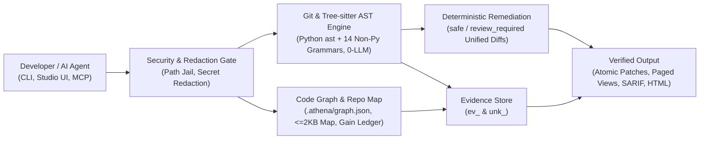
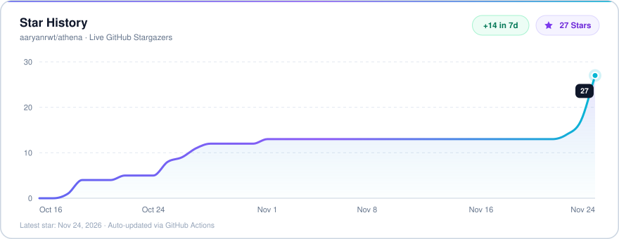

<p align="center">
  
</p>

<h1 align="center">Athena (<code>athena-mcp</code>)</h1>

<p align="center">
  <em>Your git diff says it is safe. Athena checks the callers.</em>
</p>

<p align="center">
  <a href="#v133-10-language-1000-commit-audit--auto-fix-benchmark">
    
  </a>
</p>

<p align="center">
  <a href="https://github.com/aaryanrwt/athena/actions/workflows/athena-audit.yml"></a>
  <a href="https://github.com/aaryanrwt/athena/releases"></a>
  <a href="https://github.com/aaryanrwt/athena/stargazers"></a>
  <a href="https://github.com/aaryanrwt/athena/commits/main"></a>
  <a href="LICENSE"></a>
  <br />
  <a href="https://m8ven.ai/mcp/aaryanrwt/athena?s=readme"></a>
  <a href="https://hub.xerj.org/contributors/aaryanrwt"></a>
</p>

Athena (`v1.3.3`) is a **local-first code intelligence tool** (CLI, Terminal UI, and MCP server). It runs offline on your machine—no cloud APIs or vector databases required—to help both developers and AI coding agents:

1. **Catch breaking changes with Tree-sitter & Python AST precision** (removed/signature-changed symbols, unguarded `None` defaults, unit-shift hints, recursion bugs, full-repo `git grep` caller blast radius, and `internal_only` vs `public_external` surface separation).
2. **Generate & safely apply deterministic fixes (`athena fix`)** (unified diffs tagged `safe` vs `review_required` for recursion fixes, literal `None` fallback guards, 1-to-1 Python keyword caller updates, docstring tag sync, shims, and migration guides).
3. **Map, query, and track token savings (`athena graph`, `athena map`, `athena gain`)** across Python, TypeScript/JS, Go, Rust, C/C++, C#, Java, Kotlin, Scala, Swift, Ruby, PHP, CUDA, and TeX—cutting raw repository context by **up to 99.95% (`44.2M` tokens saved across 10 enterprise repos)**.
4. **Predict affected tests, track technical debt, and plug into any AI coding agent** (`athena affected-tests`, `athena debt`, `athena install` for Hermes, OpenClaw, Claude Code, Codex, Cursor, and Pi) with optional **Hybrid Rust acceleration**.

## Table of Contents

- [Quickstart](#quickstart)
- [Everyday Commands](#everyday-commands)
- [How It Works](#how-it-works)
- [Project & Folder Architecture](#project--folder-architecture)
- [v1.3.3 10-Language 1,000-Commit Audit & Auto-Fix Benchmark](#v133-10-language-1000-commit-audit--auto-fix-benchmark)
- [v1.3.2 5-Company Benchmark & v1.3.1 Comparison](#v132-5-company-benchmark--v131-comparison)
- [Real-World Benchmark (v1.3.1)](#real-world-benchmark-v131)
- [Before vs. After Rust Integration](#before-vs-after-rust-integration)
- [Use It in GitHub Actions](#use-it-in-github-actions)
- [Star History](#star-history)
- [Further Reading](#further-reading)

---

## Quickstart

```bash
git clone https://github.com/aaryanrwt/athena.git
cd athena
pip install -e ".[ast]"   # or `pip install -e .` for minimal zero-extra structural fallback

# Open the interactive Terminal Studio
athena ui

# Get a <=2KB architectural map of any repo
athena map .

# Check staged changes before committing & preview deterministic fixes
athena check --staged
athena fix . --base main --target HEAD --format diff

# Inspect measured local token savings
athena gain .
```

---

## Everyday Commands

| Command | What it does |
| :--- | :--- |
| `athena ui` | Launches the interactive terminal studio (auto-starts when run in a terminal). |
| `athena doctor .` | Checks live Python (`>=3.13`), Git, MCP SDK, Tree-sitter, Rust acceleration, token ledger, evidence store, and repo state. |
| `athena mcp --toolsets git,graph --read-only` | Runs Athena's 15-tool MCP server (`stdio` or loopback `streamable-http`) with toolset/read-only scoping, 5 resources/templates, and 3 prompts. |
| `athena map .` | Prints a `<=2000`-character export map of shared modules and symbols. |
| `athena graph . --query "auth"` | Builds/queries `.athena/graph.json` with trigram search + hub-guarded BFS across Python, TS/JS, Go, Rust, C/C++, C#, Java, Kotlin, Scala, Swift, Ruby, PHP, CUDA, and TeX. |
| `athena breaking-changes . --base main --target HEAD` | Finds potential breaking API changes, scoped callers, and doc drift (`--detail summary` retains `ev_<sha256>` on disk). |
| `athena fix . --base main --target HEAD` | Plans and (`--apply`) safely writes deterministic `safe` remediation patches (`review_required` shims/guides require approval). |
| `athena view <ev_id> --facet potential_breaking_changes` | Pages through retained `ev_<sha256>` evidence bundles across CLI/MCP sessions. |
| `athena gain .` | Reports persistent local raw vs. compacted token-savings metrics (`~/.athena/gain.jsonl` or `$ATHENA_GAIN_LOG`). |
| `athena check --staged` | Pre-commit gate: exits non-zero if staged changes break public APIs. |
| `athena affected-tests .` | Predicts pytest, Playwright `.spec.ts`, Swift/Scala, and unit tests impacted by a diff (supports `--offset`/`--limit`). |
| `athena debt .` | Lists `shortcut: <limit>, <when to upgrade>` debt markers (or `--include-todos`) with AST symbols. |
| `athena install --agent hermes` | Installs Athena skills/hooks for `hermes`, `openclaw`, `claude-code`, `codex`, `cursor`, or `pi`. |
| `athena init-mcp cursor` | Generates ready-to-paste MCP config JSON (`claude-desktop`, `cursor`, `vscode`). |

---

## How It Works



- **Zero-LLM by default:** Everything runs deterministically offline. Local Ollama (`qwen2.5-coder:7b` / `gemma:latest`) is strictly optional (`--llm`).
- **Never fakes completeness:** Full-repo stdin `git grep` prefiltering replaces arbitrary monorepo file caps while unresolved dynamic calls (`getattr`, `eval`, oversized files) stay explicitly tracked as `ResidualUnknown` (`unk_<sha256>`) records.
- **Context-friendly & 2026 MCP native:** Heavy tools support `detail="summary"` with head+tail bounded compaction, never-worse envelopes, cross-process `ev_<sha256>` paging (`inspect_analysis_view` / `athena view`), 15 MCP tools, 5 read-only Resources/Templates (`athena://server/capabilities`, `athena://repo/map`, `athena://gain/summary`, `athena://evidence/recent`, `athena://evidence/{evidence_id}`), 3 guided workflow prompts, `--toolsets`/`--read-only` scoping, and loopback-guarded `streamable-http` transport.

---

## Project & Folder Architecture

```text
athena/
├── src/athena/
│   ├── cli.py                # CLI entry point (ui, doctor, mcp, graph, map, view, fix, gain, affected-tests, debt, install, check, report, semver-check)
│   ├── tui.py                # Interactive Athena Studio Terminal UI
│   ├── mcp_server.py         # Scoped stdio / loopback streamable-http MCP server (15 tools, 5 resources/templates & 3 prompts)
│   ├── git_inspector.py      # Safe git diff, non-UTF-8 decoder, stdin git grep prefilter & batched cat-file extractor
│   ├── ast_analyzer.py       # Python ast contract/PEP 585/unit-shift/recursion differ + multi-language overload & scoped caller engine
│   ├── treesitter_parser.py  # Optional 14-language Tree-sitter AST extractor, export-macro stripper & visibility analyzer
│   ├── remediation.py        # Deterministic dry-run & atomic `--apply` patch engine (`safe` vs `review_required`)
│   ├── token_ledger.py       # Append-only local raw vs. compacted token-savings ledger (`athena gain`)
│   ├── graph_store.py        # Persistent .athena/graph.json builder (Python, TS/JS, Go, Rust, C/C++, C#, Java, Kotlin, Scala, Swift, Ruby, PHP, CUDA, TeX)
│   ├── graph_query.py        # Trigram+IDF scorer, hub-guarded BFS, god_nodes & shortest_path
│   ├── test_selector.py      # Predictive test selection (pytest, Playwright .spec.ts/.e2e.ts, Swift/Scala/Go/Rust/unit tests)
│   ├── repo_map.py           # <=2KB zero-search architectural export map
│   ├── debt_tracker.py       # AST-bound `shortcut:` & TODO/FIXME technical debt scanner
│   ├── evidence_store.py     # Canonical ev_<sha256> & unk_<sha256> store, head+tail truncation & paged inspection
│   ├── agent_installer.py    # Transactional NUL/flag-hardened installer for Hermes, OpenClaw, Claude Code, Codex, Cursor & Pi
│   ├── gates.py              # Staged pre-commit & SemVer bump gates
│   ├── sarif.py              # SARIF 2.1.0 exporter
│   ├── html_report.py        # CSP-hardened single-file HTML report renderer
│   ├── release_notes.py      # Deterministic & optional Ollama release-note pipeline
│   ├── ollama_engine.py      # Optional local Ollama integration (gemma:latest / qwen2.5-coder:7b)
│   ├── symbol_cache.py       # Content-addressed parsed symbol cache
│   ├── mcp_config.py         # MCP client config generator (Claude Desktop, Cursor, VS Code)
│   ├── verifier.py           # Ground-truth evidence verifier & hallucination guard
│   ├── security.py           # Path jail, symlink defense, NTFS ADS guard & Rust-accelerated secret redaction
│   ├── _fast_kernels.py      # Plain-data hot kernels with verified Rust PyO3 fast-anything ports
│   └── models.py             # Pydantic v2 schemas
├── skills/athena/SKILL.md    # Portable Athena agent protocol skill
├── docs/                     # CLI examples, evaluation reports, CI/Docker integrations & demo tape
├── tests/                    # Automated unit, v1.3.3 precision/fix, MCP stdio, release-readiness & evaluation suites
├── .github/                  # CI workflows (athena-audit, action-smoke) & PR comment renderer
├── action.yml                # Reusable GitHub Action
├── Dockerfile                # Rootless container image
└── pyproject.toml            # Package & Python 3.13-3.15 metadata (`[ast]` Tree-sitter optional extra)
```

---

## v1.3.3 10-Language 1,000-Commit Audit & Auto-Fix Benchmark

`v1.3.3` replaces regex-only non-Python diffs and fixed monorepo scan caps with optional **Tree-sitter AST parsing (`[ast]`)**, single-call stdin `git grep` full-repository prefiltering, overload-order invariance, scoped receiver matching, deterministic **auto-fix patch generation (`athena fix`)**, and persistent local token telemetry (`athena gain`).

### 5-Company Regression Verification (`v1.3.2 -> v1.3.3`)

Re-running all `1,050–1,091`-commit spans from `v1.3.2` confirms both dramatic coverage expansion and false-positive elimination (**`16/16` assertions passed**):

| Enterprise Repo | Code Coverage (`v1.3.2 -> v1.3.3`) | Breaking Findings | Callers Matched (`v1.3.2 -> v1.3.3`) | Key `v1.3.3` Precision Fixes Observed |
| :--- | :---: | :---: | :---: | :--- |
| `openai/openai-python` (Python) | `37.6% (963/2,560) ->` **`99.9% (2,557/2,560)`** | `132` | `460 -> 3,841` | `CLIModels.get` bogus `_os.environ.get` callers eliminated (`0`); `SyncAPIClient.request` retained repo-wide; `156` fix patches planned |
| `microsoft/semantic-kernel` (C#/Py) | `22.8% (838/3,682) ->` **`100.0% (3,682/3,682)`** | `23 -> 27` | `124 -> 1,946` | `AggregatorAgent` (`async override` reorder) & `internal static class AgentThreadActions` false alarms suppressed (`0`) |
| `meta-llama/llama-stack` (Py/TS) | `69.6% (898/1,291) ->` **`100.0% (1,286/1,286)`** | `61` | `113 -> 27` | Cross-scope generic `list`/`main`/`list_models` caller collisions eliminated (`0`) |
| `ml-explore/mlx` (C++/Py) | `100.0% (635/635)` | `42` | `45 -> 815` | `MLX_API` macro & ctor overload index shifts suppressed (`34,849 -> 815` scoped callers); `0` Python callers on C++ `is_available`; `0` `3rdparty/` `free` callers |
| `google/go-github` (Go) | `99.4% (516/519)` | `116` | `151 -> 175` | Unexported `DependabotService.getPublicKey` suppressed (`0`); `0` `func` declarations matched; `116` migration guides planned |

### 10-Language / 1,000-Commit Individual Diff & Feature Suite

Audited `100` consecutive first-parent commits individually (`sha^1..sha`, `1,000` diffs total) across `10` newly cloned repositories spanning `10` distinct languages, captured real `git diff` excerpts for every finding, fixed 6 language-specific false positives/gaps uncovered mid-audit, and verified all CLI/MCP commands across every repo:

| Repo (Language) | Commits (`Code / Brk`) | Findings (`Before -> After Fixes`) | Avg Parse Cov | Crashes | `CodeGraph` (`Nodes / Edges`, Rust Parity) | Impacted Tests | Tokens Saved (`athena gain`) | Real Commits Caught |
| :--- | :---: | :---: | :---: | :---: | :--- | :---: | ---: | :--- |
| `microsoft/playwright` (TypeScript) | `73 / 17` | `71` (`14` pub, `57` int) | `99.72%` | `0` | `13,299 / 19,927` (`True`) | `747 / 754` | `5,453,848` (`99.95%`) | `tObject` validator change (`41963499`, `903` callers), `serializeCompilationCache` (`0288334f`) |
| `tokio-rs/tokio` (Rust) | `88 / 2` | `4` (`4` pub) | `100.0%` | `0` | `10,195 / 9,379` (`True`) | `314 / 314` | `2,698,982` (`99.91%`) | Removed `from_bytes` (`a99332ab`, `11` callers), `AsyncFdTryNewError` (`9dd749d3`) |
| `google/guava` (Java) | `77 / 1` | `17 ->` **`10`** | `100.0%` | `0` | `10,523 / 7,256` (`True`) | `1,394 / 1,394` | `8,746,769` (`99.98%`) | Caliper benchmark deletions (`fc59cc25`); `@Nullable` & inner `@Override` FPs eliminated |
| `kubernetes/client-go` (Go) | `68 / 5` | `36` (`36` pub) | `100.0%` | `0` | `23,030 / 24,714` (`True`) | `170 / 170` | `4,449,148` (`99.94%`) | KEP-5517 `NodeAllocatableMappedResources` (`6443cb62`) & DRA `ApplyConfiguration` removals |
| `pydantic/pydantic` (Python) | `45 / 2` | `7 ->` **`4`** | `99.99%` | `0` | `18,948 / 72,996` (`True`) | `2,982 / 3,092` | `3,461,283` (`99.93%`) | `@deprecated arguments_schema` (`62c615a3`), removed `validate_on_init`/`__validators__` (`2b2baae1`); PEP 585 `Dict->dict` FP eliminated |
| `abseil/abseil-cpp` (C++) | `93 / 5` | `255 ->` **`186`** | `100.0%` | `0` | `3,477 / 2,628` (`True`) | `14 / 14` | `4,377,689` (`99.95%`) | `/internal/` & `namespace ...internal` noise suppressed; `raw_linked_hash_set` (`aca5bfea`) tracked |
| `dotnet/extensions` (C#) | `55 / 3` | `19` (`10` pub, `9` int TS) | `100.0%` | `0` | `6,860 / 4,483` (`True`) | `1,070 / 1,072` | `3,939,004` (`99.93%`) | `AddHttpLatencyTelemetry` rename (`81ba00bd`), OpenAI Assistants API removal (`d0caf643`) |
| `square/okhttp` (Kotlin) | `30 / 0` | `0` | `100.0%` | `0` | `5,650 / 5,003` (`True`) | `248 / 248` | `1,667,961` (`99.84%`) | Clean zero-false-positive pass across `30` code-modifying commits |
| `apple/swift-nio` (Swift) | `69 / 5` | `30 ->` **`16`** | `99.99%` | `0` | `10,904 / 10,448` (`True`) | `229 / 229` | `1,446,512` (`99.84%`) | `NIOHTTPServerPipelineConfiguration` revert (`2f58d8ef`), `Sendable -> sending` (`fcc5b9c1`); `@available` & `@inlinable` FPs eliminated |
| `laravel/framework` (PHP) | `79 / 1` | `4 ->` **`1`** | `99.99%` | `0` | `41,181 / 37,978` (`True`) | `1,346 / 1,363` | `5,396,562` (`99.97%`) | Deleted `PhpRedisConnection::isRetryable` (`3c8d07f4`); optional `$options = []` & `__construct` FPs eliminated |

- **Precision & Coverage Gains from Real Diff Auditing:** Fixing the 6 bugs caught during the 10-language audit cut noisy breaking alerts from **`59 -> 41` commits (`443 -> 347` findings)** with **`0` crashes**, expanded `apple/swift-nio` graph indexing from **`88 -> 10,904` nodes (`5 -> 229` affected tests)** with bit-exact Rust parity, compressed **`44,250,647` raw tokens into `23,667` emitted tokens (`99.95%` saved across `31` logged runs)**, applied a live deterministic `none_guard` patch on an isolated temp clone via `athena fix --apply`, and passed **`195 passed, 1 deselected`** across all 3 test modes (Tree-sitter+Rust ON, `ATHENA_TREESITTER_DISABLE=1`, and `FAST_ANYTHING_DISABLE=1`). Full breakdowns and diffs: [docs/evaluation.md](docs/evaluation.md).

---

## v1.3.2 5-Company Benchmark & v1.3.1 Comparison

Tested offline across **5 fresh enterprise repositories** (`1,050–1,091` commits each; **`5,291` commits** and **`63.8M` raw tokens / `255.2 MB`** total). Across these repositories, Athena surfaced **`366` potential breaking API changes** (`274` high, `92` medium), **`893` affected caller sites** (`148` findings with direct in-repo callers), and **`2,180` impacted tests**, alongside **`1,991` graph unknowns** (`80` unresolved dynamic calls):

### What Athena Found in These 5 Repositories

- **Google (`google/go-github`, Go — `1,050` commits):** Found **`111` breaking changes** (`92` high, `19` medium), **`151` affected callers** across `31` findings, and **`238` impacted tests**. Caught breaking signature rewrites in `github/actions_secrets.go` and `github/dependabot_secrets.go` where `CreateOrUpdateRepoSecret` / `CreateOrUpdateOrgSecret` changed `(..., eSecret *EncryptedSecret)` to `(..., name string, body SecretRequest)` / `SecretOrgRequest` (`10` callers each), `GetEnvPublicKey` / `ListEnvSecrets` / `ListEnvVariables` replaced `repoID int` with `(owner, repo, env string)`, and `DependabotService.getPublicKey` (`8` callers) and `ActionsService.EditActionsAllowed` (`5` callers) were removed.
- **Apple (`ml-explore/mlx`, C++/Python — `1,050` commits):** Found **`39` breaking changes** (`39` high), **`45` affected callers** across `14` findings, and **`69` impacted tests**. Caught `array::set_data(allocator::Buffer buffer, Deleter d)` rewritten to `array::set_data(allocator::Data data)` in `mlx/array.cpp`, stride arguments (`lda`, `ldb`, `ldc`, `ld`) added to `simd_gemm` / `load_block` (`mlx/backend/cpu/gemms/simd_gemm.h`), `float* acc` added to `_qmm` (`mlx/backend/cpu/quantized.cpp`), plus removed `free(Buffer)` (`mlx/allocator.cpp`) and backend `is_available()` symbols (`10` callers each).
- **OpenAI (`openai/openai-python`, Python — `1,091` commits):** Found **`132` breaking changes** (`73` high, `59` medium), **`460` affected callers** across `65` findings, and **`397` impacted tests**. Caught `SyncAPIClient.request` in `src/openai/_base_client.py` dropping positional `remaining_retries` (`10` callers), `AsyncAPIClient.request` changing signature (`9` callers), and removed CLI command handlers under `src/openai/cli/` (`CLIChatCompletion.create`, `CLICompletions.create`, `CLIFile.create`/`get`/`list`, `CLIImage.create`, `CLIModels.get`/`list`, `cli/_cli.py:main`, `10` callers each).
- **Meta (`meta-llama/llama-stack`, Python/TS — `1,050` commits):** Found **`61` breaking changes** (`47` high, `14` medium), **`113` affected callers** across `23` findings, and **`482` impacted tests**. Caught removal of `LlamaCLIParser.parse_args`, `LlamaCLIParser.run`, `Subcommand.create`, `src/llama_stack/cli/llama.py:main`, OpenAPI client SDK CLI entrypoints (`client-sdks/openapi/merge_stainless_config.py:main`, shield CLI commands, `10` callers each), and shared helpers (`print_subcommand_description`, `print_table`, `parse_endpoint`). Also exposed a real `300.14s` timeout in `v1.3.1` that `v1.3.2` fixed down to `37.57s`.
- **Microsoft (`microsoft/semantic-kernel`, C#/Python — `1,050` commits):** Found **`23` breaking changes** (`23` high), **`124` affected callers** across `15` findings, and **`994` impacted tests**. Caught the .NET Agent Framework signature redesign of `InvokeAsync` and `InvokeStreamingAsync` in `AzureAIAgent.cs`, `BedrockAgent.cs`, and `ChatCompletionAgent.cs` (changing return types from `IAsyncEnumerable<ChatMessageContent>` to `IAsyncEnumerable<AgentResponseItem<ChatMessageContent>>` and replacing `threadId`/`sessionId`/`ChatHistory` with `(ICollection<ChatMessageContent> messages, AgentThread? thread = null, ...)`, `10` callers each) plus removed methods in `ChatHistoryKernelAgent.cs` (`10` callers each).

| Company & Repo | Commits | Found (Breaking / Callers) | Scan Time (`v1.3.1 -> v1.3.2`) | Map Token Savings |
| :--- | :---: | :---: | :--- | ---: |
| **Google** (`google/go-github`, Go) | `1,050` | `111` breaks · `151` callers | `133.26s ->` **`22.15s`** `(6.02x faster)` | **`5,103.0x`** |
| **Apple** (`ml-explore/mlx`, C++/Py) | `1,050` | `39` breaks · `45` callers | `176.68s ->` **`11.12s`** `(15.89x faster)` | **`6,026.7x`** |
| **OpenAI** (`openai/openai-python`, Py) | `1,091` | `132` breaks · `460` callers | `284.69s ->` **`30.98s`** `(9.19x faster)` | **`11,246.0x`** |
| **Meta** (`meta-llama/llama-stack`, Py/TS) | `1,050` | `61` breaks · `113` callers | `TIMEOUT 300.14s ->` **`37.57s`** `(>8.0x)` | **`81,438.6x`** |
| **Microsoft** (`microsoft/semantic-kernel`, C#/Py) | `1,050` | `23` breaks · `124` callers | `223.71s ->` **`12.48s`** `(17.92x faster)` | **`24,290.1x`** |

Across these runs, `v1.3.2` cut breaking-change scan times **6.02x–17.92x** (fixing the `llama-stack` timeout), compressed `3.13–12.03 MB` JSON payloads to `644–646 B` summaries with working disk-backed `athena view` (`rc=1 -> rc=0` on `5/5` repos), and passed strict contract checks (`INVALID_MAX_CHARS`, paged `affected-tests`, `athena doctor`). Full timings, SHA-256 parity hashes, and `v1.3.1 -> v1.3.2` CLI checks: [docs/evaluation.md](docs/evaluation.md).

---

## Real-World Benchmark (v1.3.1)

Tested offline across **13 new repositories** (**3 NVIDIA 2026 & CUDA repos** over `1,000+` commits + **10 diverse high-star repos** across JS, TS/Go, Rust, C/C#, Kotlin, Ruby, PHP, TeX): **13/13 passed with 0 errors**.

| Repository | Language | Stars | Span | Files | Nodes / Edges | Cold -> Warm Cache | Token Reduction |
| :--- | :--- | ---: | :--- | ---: | ---: | ---: | ---: |
| `NVIDIA/auto-ontology` | Python (2026) | 14,568 | `HEAD~1000` | 897 | 7,486 / 23,258 | 33.3s -> 1.9s | **618.6x** |
| `NVIDIA/NeMo-Relay` | Rust (2026) | 257 | `HEAD~1000` | 1,560 | 32,331 / 48,324 | 82.3s -> 6.7s | **3,025.0x** |
| `NVIDIA/cuvs` | CUDA / C++ | 903 | `HEAD~1000` | 1,269 | 6,148 / 7,184 | 34.2s -> 1.8s | **1,330.2x** |
| `facebook/react` | JavaScript | 252,934 | `HEAD~100` | 4,161 | 20,714 / 19,216 | 236.8s -> 12.5s | **1,453.0x** |
| `microsoft/PowerToys` | C / C# | 141,325 | `HEAD~100` | 2,415 | 9,088 / 6,780 | 128.3s -> 6.3s | **1,258.6x** |
| `microsoft/TypeScript` | TypeScript / Go | 111,875 | `HEAD~100` | 503 | 7,879 / 7,907 | 29.3s -> 2.8s | **1,052.1x** |
| `fatedier/frp` | Go | 110,732 | `HEAD~100` | 247 | 2,653 / 2,436 | 11.7s -> 1.0s | **250.3x** |
| `denoland/deno` | Rust | 109,038 | `HEAD~100` | 1,697 | 33,010 / 35,688 | 107.6s -> 8.6s | **2,411.5x** |
| `laravel/laravel` | PHP / Blade | 85,480 | `HEAD~1000` | 24 | 81 / 69 | 1.4s -> 0.2s | **4.4x** |
| `rails/rails` | Ruby | 59,182 | `HEAD~1000` | 3,099 | 20,635 / 19,311 | 129.3s -> 12.0s | **1,335.2x** |
| `JetBrains/kotlin` | Kotlin | 53,614 | `HEAD~100` | 4,406 | 16,278 / 12,611 | 183.1s -> 9.7s | **1,794.9x** |
| `dotnet/runtime` | C# | 18,461 | `HEAD~100` | 4,334 | 18,661 / 14,424 | 229.6s -> 11.4s | **1,978.0x** |
| `latex3/latex2e` | TeX | 2,523 | `HEAD~1000` | 154 | 561 / 393 | 9.8s -> 0.4s | **1,527.1x** |

## Before vs. After Rust Integration

Athena keeps its Python CLI, MCP server, Pydantic schemas, and Python `ast` precision intact (`pip install athena-mcp` works anywhere with pure-Python fallback), while porting its hottest pure kernels to Rust PyO3 extensions via [`EL4CTEO/fast-anything`](https://github.com/EL4CTEO/fast-anything) and batching Git blob reads (`git cat-file --batch`).

### 3-Company `1,000+` Commit Before vs. After Quality & Parity Audit

Verified side-by-side (`FAST_ANYTHING_DISABLE=1` pure Python vs. Rust PyO3 enabled) across **NVIDIA**, **Google**, and **Microsoft** repositories over **`1,000–1,472` commits** each (`HEAD~1000..HEAD`):

| Company & Repo | Span (`HEAD~1000..HEAD`) | Scale (`Files / Nodes / Edges`) | Graph Build (Before -> After) | 20 Queries (Before -> After) | Total Pipeline (Before -> After) | Quality & SHA-256 Parity |
| :--- | :--- | :--- | ---: | ---: | ---: | :--- |
| **NVIDIA** (`NVIDIA/cuvs`) | **1,472 commits** (`8b03db68..0bc18670`) | `1,269 / 6,152 / 7,188` | 29.89s -> **1.33s (`22.48x`)** | 6.04s -> **0.74s (`8.19x`)** | 89.49s -> **28.78s (`3.11x`)** | **14/14 checks identical** (`21` breaks, `306` tests, `ev_ddbf63fa...5b07d`) |
| **Google** (`google/flatbuffers`) | **1,000 commits** (`e08da4de..5eb190f0`) | `1,196 / 11,954 / 19,419` | 43.39s -> **1.62s (`26.73x`)** | 3.22s -> **2.21s (`1.46x`)** | 74.31s -> **24.12s (`3.08x`)** | **14/14 checks identical** (`34` breaks, `831` tests, `ev_c1075fe1...f9fe6`) |
| **Microsoft** (`microsoft/playwright-python`) | **1,000 commits** (`f6726115..c830b5f8`) | `725 / 12,176 / 100,818` | 45.78s -> **12.22s (`3.75x`)** | 14.90s -> 15.96s (`0.93x`*) | 112.03s -> **87.93s (`1.27x`*)** | **14/14 checks identical** (`18` breaks, `604` tests, `ev_dacea634...74a8`) |

*\*Note on `microsoft/playwright-python`: it is predominantly `.py` files (Python `ast.parse` stays in Python) with `100,818` edges iterated in Python's `_build_adj` on each query (`14.90s -> 15.96s`); in that single run, Python's `run_breaking_change_detection` took `35.89s -> 52.27s` due to cold/warm Windows `git.exe`/OS cache variance on Python AST diffs while `predict_affected_tests` dropped `15.47s -> 7.48s` (`2.07x`), yielding `1.27x` total.*

- **0 bugs / 0 regressions introduced by Rust:** Every single SHA-256 `graph_evidence_id`, `completeness` status, node/edge/unknown count, community label, 20 query subgraphs, breaking-change finding list, doc drift count, and predicted test list matched bit-for-bit across all 3 enterprise repositories.
- **Verified Kernel Micro-Benchmarks (`fast-anything verify`) & Batch Git:** `redact_secrets` **41x** (`237.3us -> 5.8us`, `776/776`), `score_graph_trigrams` **8.8x** (`37.3ms -> 4.2ms`, `330/330`), `compute_community_assignments` **3.5x** (`9.6ms -> 2.7ms`, `206/206`), `extract_structural_symbols_raw` **1.9x** (`16.2us -> 8.6us`, `800/800`), plus batched `git cat-file --batch` cutting Athena (`v1.0.0..v1.3.1`) breaking-change analysis **4.02x** (`12.74s -> 3.17s`). (`parse_unified_diff_raw` matched `229/229` calls but measured `3.1x` slower via PyO3 FFI allocation overhead, so it was intentionally kept in Python.)

```bash
# Optional: compile native Rust accelerations locally into .fast/lib/
python scripts/build_rust_accel.py

# Toggle pure-Python fallback at any time
FAST_ANYTHING_DISABLE=1 athena graph . --query "auth"
```

Full version-by-version test history (`v1.0.0` -> `v1.3.3`) and Rust parity audit: [docs/evaluation.md](docs/evaluation.md).

---

## Use It in GitHub Actions

```yaml
- uses: actions/checkout@3d3c42e5aac5ba805825da76410c181273ba90b1 # v7.0.1
  with:
    fetch-depth: 0
- uses: aaryanrwt/athena@v1.3.3
```

Posts one sticky breaking-change & blast-radius summary per PR. See [docs/integrations.md](docs/integrations.md) for Docker, pre-commit, and permissions setup.

---

## Star History

<p align="center">
  <a href="https://github.com/aaryanrwt/athena/stargazers">
    
  </a>
</p>

---

## Further Reading

- [CLI Examples](docs/cli-examples.md)
- [Benchmarks & Evaluation](docs/evaluation.md)
- [CI, Docker & Pre-Commit Integrations](docs/integrations.md)
- [Changelog](CHANGELOG.md)
- [Security Policy](SECURITY.md)
- [Contributing](CONTRIBUTING.md)

**Maintainer:** Aaryan Rawat ([`aaryan28rwt@gmail.com`](mailto:aaryan28rwt@gmail.com)) · Licensed under [Apache-2.0](LICENSE).
